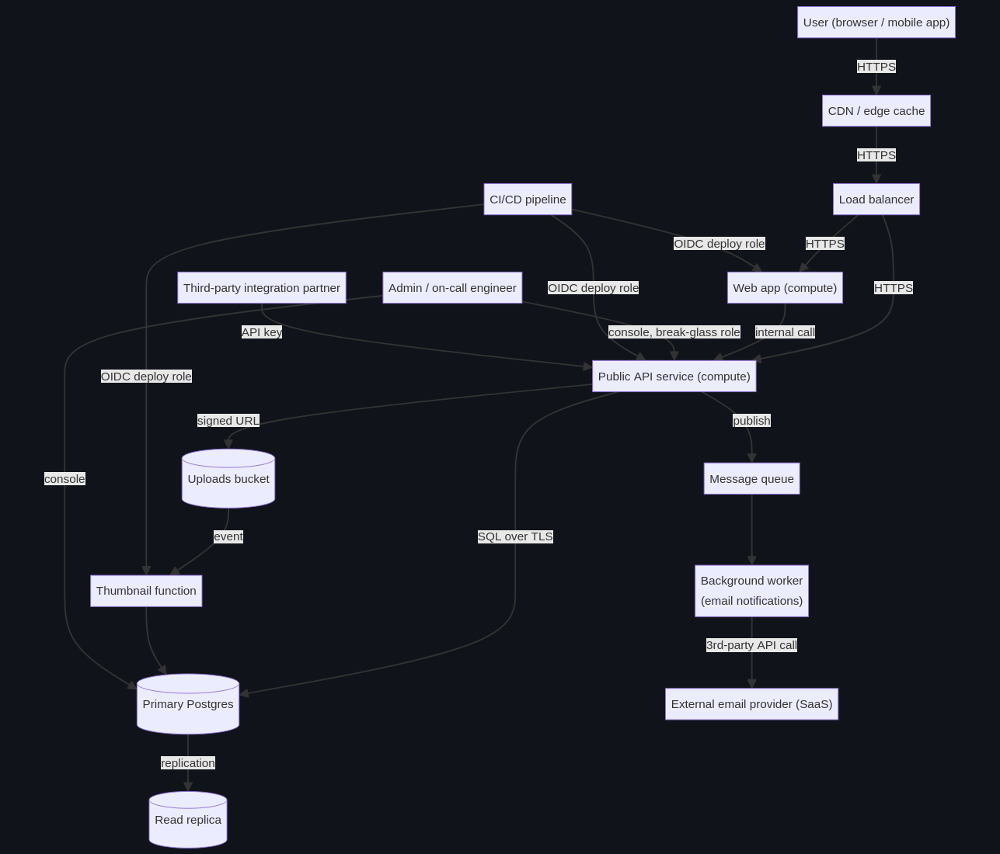

## Architecture

## Assets
| asset_id | name | asset_type | cloud | owner | data_class | notes |
|---|---|---|---|---|---|---|
| 1 | User (Browser/Mobile) | external | n/a | End Users | confidential | User credentials, session tokens, personal files being uploaded. |
| 2 | CDN / Edge Cache | network | aws | Edge Team | public | Cached static website assets (images, CSS, JS), public API responses. |
| 3 | Load Balancer | network | aws | Network Team | internal | IP addresses, routing rules, ephemeral TLS termination data. |
| 4 | Web App (Compute) | compute | aws | Frontend Team | confidential | Frontend code, user session states, transient user data in memory. (Internal/Confidential) |
| 5 | Public API Service (Compute) | compute | aws | Backend Team | restricted | API keys, business logic, user authentication tokens, transient database queries. (Confidential/Restricted) |
| 6 | Primary Postgres | database | aws | DBA Team | restricted | The crown jewels. User accounts, hashed passwords, core business records, financial data. |
| 7 | Read Replica | database | aws | DBA Team | restricted | A duplicate of the Primary Postgres data (read-only). |
| 8 | Uploads Bucket | storage | aws | Storage Team | confidential | User-uploaded files (images, documents, PDFs). |
| 9 | Thumbnail Function | compute | aws | Serverless Team | confidential | Transient image data in memory, emitting logs containing PII info, function code. (Internal/Confidential) |
| 10 | Message Queue | messaging | aws | Messaging Team | confidential | Asynchronous job payloads (e.g., email addresses, notification text). |
| 11 | Background Worker | compute | aws | Backend Team | confidential | Email templates, User email addresses. |
| 12 | CI/CD Pipeline | compute | aws | DevOps Team | restricted | Source code, deployment artifacts, build secrets, OIDC deployment tokens. |
| 13 | Admin/On-call Engineer | identity | aws | Security Team | restricted | Admin credentials, MFA tokens, break-glass authorization keys. |
| 14 | External Email Provider | saas | saas | Third-party | confidential | User email addresses, email content. |
| 15 | Third-party Integration | external | saas | Partnerships Team | confidential | API keys, partner business data. |

## Entry Points (Where data enters)
1. The Public Web Interface (The CDN & Load Balancer)
• Who/What: The User (Browser/Mobile app).

2. The Partner API Interface (Public API Service)
◇ Who/What: Third-party Integration Partner.

3. The Administrative Interface (Public API Service)
◇ Who/What: Admin / On-call engineer.

4. The Event Trigger (Uploads Bucket to Thumbnail Function)
◇ Who/What: The cloud provider's internal event system.
Note: This one seems difficult to spot since the traffic is not initiating from external component but actually image is directly uploaded from external user to upload bucket.

5. The Code Deployment Path (CI/CD to Compute)
◇ Who/What: The CI/CD Pipeline.

## Trust Boundaries
1. The Perimeter Boundary (Untrusted to Semi-Trusted)
- Where it is: Between the User/Partner and the CDN / Load Balancer / Web App.

2. The Application Segmentation Boundary (Semi-Trusted to Internal)
- Where it is: Between the Load Balancer/Web App and the Public API Service.

3. The Data Boundary (Internal to Restricted)
- Where it is: Between the Public API/Thumbnail Function/Background Worker and the Primary Postgres / Uploads Bucket.

4. The Execution Boundary (Untrusted to internal)
- Where it is: Between the Uploads Bucket and the Thumbnail Function.

5. The Management Boundary (high-trust to internal)
- Where it is: Between the CI/CD Pipeline / Admin and the Production Compute.

6. The Egress Boundary (Internal to Untrusted)
- Where it is: Between the Background Worker and the External Email Provider.

7. The Partner API Boundary (untrusted to internal)
- Where it is: Between the Third-party Integration Partner and the Public API Service.

8. background worker boundary(internal to internal)
- Where it is: Between API and  message queue/bg worker

## Threat Modeling
| # | Boundary | STRIDE | Threat | Likelihood | Impact | Responsible Party | Mitigation Control |
|---|----------|--------|--------|------------|--------|-------------------|---------------------|
| 1 | Perimeter | Spoofing | Stolen user session token via XSS | 3 | 4 | Customer | Set HttpOnly and Secure flags on session cookies so JavaScript cannot read them. Implement a strict Content Security Policy (CSP) to block XSS execution. |
| 2 | Perimeter | Tampering | User data in transit gets tampered with MITM attack since TLS key was exposed via TLS downgrading (like POODLE) | 3 | 4 | Customer | Enforce TLS 1.2 or 1.3 only at the Load Balancer/CDN; disable all legacy protocols and weak cipher suites. Implement HSTS (HTTP Strict Transport Security). |
| 3 | Perimeter | Repudiation | A normal user deleted his own account and denies the action ("My account was hacked") since the action was not properly logged with IP and exact timestamp | 3 | 2 | Customer | Enable edge access logging (WAF/LB logs) to capture source IPs and precise timestamps. Send these logs to an immutable storage bucket. |
| 4 | Perimeter | Information Disclosure | User sessions and data in transit get exposed due to TLS key leak via TLS downgrading (like POODLE) | 3 | 4 | Customer | Enforce TLS 1.2+ with AEAD ciphers (like AES-GCM); disable weak cipher suites. |
| 5 | Perimeter | DoS | Volumetric DDoS attack against Load balancer/webapp | 3 | 2 | Customer | Use a cloud provider's DDoS protection (e.g., AWS Shield) and a CDN to absorb traffic. Implement rate limiting at the Load Balancer. |
| 6 | Perimeter | Elevation of Privilege | Privileged users' tokens get stolen via XSS | 3 | 5 | Customer | Use short-lived tokens; require MFA for privileged actions; isolate admin privileges in a separate, highly secure context. |
| 7 | Application | Spoofing | Stolen user token and spoofing as web app (attacker directly requesting API bypassing webapp) | 2 | 4 | Customer | Validate the Web App's identity to the API using mTLS (Mutual TLS) or a strict service-to-service JWT, not just relying on the user's token. |
| 8 | Application | Tampering | Tampers another user's data with IDOR | 3 | 4 | Customer | Implement strict object-level authorization (BOLA/BFLA checks) in the API to ensure the authenticated user actually owns the resource they are modifying. |
| 9 | Application | Information Disclosure | Access another user's data with stolen token | 2 | 4 | Customer | Apply the Principle of Least Privilege to tokens; restrict data returned to only what the user needs (prevent over-fetching). |
| 10 | Application | Elevation of Privilege | Letting web app use master token access to API instead of normal user token so if the web app gets compromised, not just user related stuff gets exposed, the other data stored gets exposed too | 4 | 5 | Customer | Never give the Web App a master token. Forward the user's specific token to the API and enforce user-level authorization on every request. |
| 11 | Data | Spoofing | Attacker spoofing as API via stolen API role token or DB user's static creds | 2 | 4 | Customer | Use IAM database authentication with short-lived tokens (valid for 15 minutes) instead of static passwords; store any remaining secrets in a Secrets Manager; restrict database network access to private subnets only. |
| 12 | Data | Tampering | Modifying sensitive data stored on DB (e.g., SQL injection) | 3 | 4 | Customer | Use parameterized queries (prepared statements) to prevent SQL injection; enforce strict database-level write constraints. |
| 13 | Data | Information Disclosure | Exposing sensitive user data | 2 | 4 | Customer | Encrypt data at rest (TDE or disk-level encryption). |
| 14 | Data | Elevation of Privilege | Modifying IAM if the API role's DB access policy is over-permissioned | 4 | 5 | Customer | Enforce Principle of Least Privilege at the database level (GRANT SELECT, INSERT on specific tables only; never SUPERUSER); scope the role only to specific DB actions (e.g., rds-db:connect). |
| 15 | Data | DoS | Resource locking on DB so it no longer functions properly (e.g., running a query that locks tables like `LOCK TABLE users IN EXCLUSIVE MODE;`) | 3 | 2 | Customer | Set strict query timeouts; implement connection pooling limits (DB will only receive limited number of connections it can handle); use a Read Replica for heavy read queries to protect the Primary DB. |
| 16 | Execution | Spoofing | Although this is API flaw, spoofing is possible if the attacker can trick the API to generate signed URL for another user | 2 | 4 | Customer | The API must verify the user's authorization to the exact target path before generating the signed URL. |
| 17 | Execution | DoS | Uploading a malicious image (e.g., zip bomb: highly compressed file) crashing the function | 3 | 2 | Customer | Implement strict file size limits and memory/timeout constraints on the serverless function. Validate image dimensions before unpacking. |
| 18 | Execution | Information Disclosure | Uploads bucket could be set to public, exposing data to everyone on the internet | 4 | 4 | Customer | Enable S3 Block Public Access at the account level. Serve files using time-limited signed URLs, not public ACLs. |
| 19 | Execution | Repudiation | The origin of upload as each user is not properly logged | 3 | 2 | Customer | Enable bucket access logging and log the S3 event metadata (IAM principal, source IP) inside the Thumbnail Function. |
| 20 | Execution | Tampering | Upload image as another user thereby tampering the victim's data | 2 | 4 | Customer | Scope signed URLs to unique, user-specific paths (/uploads/{user_id}/) and verify the uploader's identity via metadata. |
| 21 | Execution | Elevation of Privilege | Uploading malicious image and cause remote code execution as function role | 3 | 5 | Customer | Run the function in an isolated VPC with no internet access; validate file "magic bytes" (true file type); apply least privilege to the function's IAM role. |
| 22 | Management | Spoofing | Admin console gets exposed to public network and hit with bruteforce attacks or CI/CD pipeline gets compromised via malicious pull request (e.g., Code execution in base repository context) | 4 | 5 | Customer | Place admin consoles behind a VPN or Zero Trust Network Access (ZTNA); require hardware MFA. Enforce branch protection and mandatory code review for PRs. |
| 23 | Management | Tampering | Tampering API code as a result of spoofing | 3 | 5 | Customer | Require cryptographic code signing for deployment artifacts; enforce strict CI/CD pipeline access controls. |
| 24 | Management | Repudiation | Bad admin tampering API code is not logged | 3 | 4 | Customer | Send CI/CD and admin logs to an immutable, write-once-read-many (WORM) storage bucket in a separate, highly restricted security account. |
| 25 | Management | Information Disclosure | Deployment artifacts containing API keys are not properly stored | 4 | 4 | Customer | Never hardcode secrets; inject secrets at runtime using a Secrets Manager (e.g., Vault, AWS Secrets Manager); scan repos for secrets before committing. |
| 26 | Management | DoS | The "Oops" DoS: A developer pushes a config change that accidentally drops the database connection pool, causing the API to crash globally (the damage can be done without any malice) | 1 | 2 | Customer | Implement automated canary deployments; require health checks and automatic rollbacks if error rates spike after a deployment. |
| 27 | Management | Elevation of Privilege | CI/CD role is over-permissioned | 4 | 5 | Customer | Strictly scope the CI/CD IAM role to only the specific deployment resources needed; never grant AdministratorAccess. |
| 28 | Egress | Spoofing | Provider spoofing by DNS poisoning, MITM or worker spoofing by stolen API key | 3 | 4 | Customer | Store the API key in Secrets Manager, TLS enforcing with strict certificate validation, IP allow listing. |
| 29 | Egress | Tampering | MITM email tampering | 3 | 4 | Customer | Use TLS. |
| 30 | Egress | Information Disclosure | Worker lazily sends the whole user profile instead of email to provider, if provider gets breached, all hell will break loose | 4 | 4 | Customer | Data minimization. |
| 31 | Egress | Elevation of Privilege | The API key is scoped too broad more than sending email. The entire email domain can get exposed | 4 | 5 | Customer | Principle of least privilege. |
| 32 | Partner API | Spoofing, Tampering, Information Disclosure, DoS | Stolen API key via MITM, code and logs | 3 | 4 | Customer | Don't hardcode API key, use strict TLS enforcing, there is upgraded version called mTLS (mutual TLS) which also requires client's certificate. |
| 33 | Partner API | Repudiation | Partner API call is not properly logged | 3 | 2 | Customer | Immutable Audit Logging (Write-Once-Read-Many / WORM storage), log API Key ID, Source IP, Timestamp, Endpoint, HTTP Method, and Response Code. |
| 34 | Partner API | Elevation of Privilege | API key is scoped too broad for API access | 4 | 4 | Customer | Principle of least privilege. |
| 35 | Background Worker | Spoofing | Publisher and subscriber are not properly authenticated | 4 | 4 | Customer | Queue level access policy with strictly scoped API and worker IAM roles. |
| 36 | Background Worker | DoS | Malicious message crashes the background worker | 3 | 2 | Customer | Properly sanitize the message schema and send the message to Dead Letter Queue if fail to sanitize properly. |

### Top 10 Risks (Ordered by Risk Score)

| threat_id | stride_category | description | likelihood | impact | risk_score | mitigating_control | affected_assets |
|---|---|---|---|---|---|---|---|
| 31 | Elevation | The API key is scoped too broad more than sending email. The entire email domain can get exposed | 4 | 5 | 20 | Principle of least privilege. | Background Worker \| External Email Provider |
| 27 | Elevation | CI/CD role is over-permissioned | 4 | 5 | 20 | Strictly scope the CI/CD IAM role to only the specific deployment resources needed; never grant AdministratorAccess. | CI/CD Pipeline \| Web App (Compute) \| Public API Service (Compute) |
| 22 | Spoofing | Admin console gets exposed to public network and hit with bruteforce attacks or CI/CD pipeline gets compromised via malicious pull request (e.g., Code execution in base repository context) | 4 | 5 | 20 | Place admin consoles behind a VPN or Zero Trust Network Access (ZTNA); require hardware MFA. Enforce branch protection and mandatory code review for PRs. | CI/CD Pipeline \| Admin/On-call Engineer \| Web App (Compute) \| Public API Service (Compute) |
| 14 | Elevation | Modifying IAM if the API role's DB access policy is over-permissioned | 4 | 5 | 20 | Enforce Principle of Least Privilege at the database level (GRANT SELECT, INSERT on specific tables only; never SUPERUSER); scope the role only to specific DB actions (e.g., rds-db:connect). | Public API Service (Compute) \| Primary Postgres |
| 10 | Elevation | Letting web app use master token access to API instead of normal user token so if the web app gets compromised, not just user related stuff gets exposed, the other data stored gets exposed too | 4 | 5 | 20 | Never give the Web App a master token. Forward the user's specific token to the API and enforce user-level authorization on every request. | Web App (Compute) \| Public API Service (Compute) |
| 35 | Spoofing | Publisher and subscriber are not properly authenticated | 4 | 4 | 16 | Queue level access policy with strictly scoped API and worker IAM roles. | Public API Service (Compute) \| Message Queue \| Background Worker |
| 34 | Elevation | API key is scoped too broad for API access | 4 | 4 | 16 | Principle of least privilege. | Third-party Integration \| Public API Service (Compute) |
| 30 | Info Disclosure | Worker lazily sends the whole user profile instead of email to provider, if provider gets breached, all hell will break loose | 4 | 4 | 16 | Data minimization. | Background Worker \| External Email Provider |
| 25 | Info Disclosure | Deployment artifacts containing API keys are not properly stored | 4 | 4 | 16 | Never hardcode secrets; inject secrets at runtime using a Secrets Manager (e.g., Vault, AWS Secrets Manager); scan repos for secrets before committing. | CI/CD Pipeline |
| 18 | Info Disclosure | Uploads bucket could be set to public, exposing data to everyone on the internet | 4 | 4 | 16 | Enable S3 Block Public Access at the account level. Serve files using time-limited signed URLs, not public ACLs. | Uploads Bucket |

### Everything Touching the Third-Party Partner

| threat_id | stride_category | description | likelihood | impact | mitigating_control | other_affected_asset |
|---|---|---|---|---|---|---|
| 32 | Spoofing, Tampering, Info Disclosure, DoS | Stolen API key via MITM, code and logs | 3 | 4 | Don't hardcode API key, use strict TLS enforcing, there is upgraded version called mTLS (mutual TLS) which also requires client's certificate. | Public API Service (Compute) |
| 33 | Repudiation | Partner API call is not properly logged | 3 | 2 | Immutable Audit Logging (Write-Once-Read-Many / WORM storage), log API Key ID, Source IP, Timestamp, Endpoint, HTTP Method, and Response Code. | Public API Service (Compute) |
| 34 | Elevation | API key is scoped too broad for API access | 4 | 4 | Principle of least privilege. | Public API Service (Compute) |

### Threats With No Mitigating Control Yet

| threat_id | stride_category | description | likelihood | impact |
|---|---|---|---|---|
| — | — | No threats found with NULL or empty mitigating_control | — | — |
